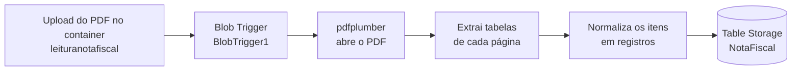

# Leitura de Nota Fiscal

Azure Function em Python que lê automaticamente notas fiscais em PDF enviadas para o Azure Blob Storage, extrai a tabela de produtos e grava cada item no Azure Table Storage.

## Como funciona



1. **Gatilho** — a função é disparada quando o arquivo `arquivo.pdf` é gravado no container `leituranotafiscal`.
2. **Leitura** — o conteúdo do blob é carregado em memória (`BytesIO`) e aberto com `pdfplumber`.
3. **Extração** — percorre todas as páginas e coleta as tabelas encontradas.
4. **Normalização** — a coluna de produtos é dividida linha a linha e cada item vira um registro com `codigo`, `descricao`, `qtd`, `unidade`, `valor_unitario` e `valor_total`.
5. **Persistência** — os registros são serializados em JSON e enviados para a tabela `NotaFiscal` através do binding de saída (`table_output`).

Cada registro recebe `PartitionKey = "item_nota_fiscal"` e um `RowKey` gerado com `uuid4()`.

## Estrutura do projeto

| Arquivo | Descrição |
| --- | --- |
| `function_app.py` | Código da função (modelo de programação v2 do Azure Functions). |
| `auxiliar.py` | Versão anterior do código, mantida comentada como referência histórica. |
| `host.json` | Configuração do host (extension bundle v4, Application Insights). |
| `local.settings.json` | Configurações locais (connection strings apontando para o Azurite). |
| `requirements.txt` | Dependências Python. |

## Pré-requisitos

- Python 3.9+
- [Azure Functions Core Tools v4](https://learn.microsoft.com/azure/azure-functions/functions-run-local)
- [Azurite](https://learn.microsoft.com/azure/storage/common/storage-use-azurite) (emulador de storage para execução local)

## Dependências

O arquivo `requirements.txt` declara:

```text
azure-functions
azurefunctions-extensions-bindings-blob
```

> **Atenção:** `function_app.py` também importa `pdfplumber` e `pandas`. Se ainda não estiverem em `requirements.txt`, adicione-os antes de publicar, caso contrário a função falhará na nuvem:
>
> ```text
> pdfplumber
> pandas
> ```

## Executando localmente

```powershell
# 1. Criar e ativar o ambiente virtual
python -m venv .venv
.\.venv\Scripts\Activate.ps1

# 2. Instalar as dependências
pip install -r requirements.txt

# 3. Iniciar o Azurite (em outro terminal)
azurite

# 4. Iniciar a Function
func start
```

Com a função em execução, envie um PDF chamado `arquivo.pdf` para o container `leituranotafiscal` (via Azure Storage Explorer ou Azure CLI) para disparar o processamento.

## Configuração

As chaves usadas pela função estão em `local.settings.json`:

| Chave | Finalidade |
| --- | --- |
| `AzureWebJobsStorage` | Conexão do blob trigger e do runtime. |
| `BlobConnection` | Conexão de blob adicional. |
| `TableConnection` | Conexão usada pelo binding de saída `table_output`. |
| `FUNCTIONS_WORKER_RUNTIME` | Define o runtime como `python`. |

Localmente todas apontam para `UseDevelopmentStorage=true` (Azurite). Ao publicar no Azure, configure os valores equivalentes em **Application settings** da Function App.

> `local.settings.json` não deve conter segredos reais versionados — ele já está listado no `.funcignore`.

## Deploy no Azure

```powershell
func azure functionapp publish <nome-da-function-app>
```

Após o deploy, cadastre as application settings (`AzureWebJobsStorage`, `BlobConnection`, `TableConnection`) no portal ou via Azure CLI.

## Limitações conhecidas

- O caminho do gatilho é fixo (`leituranotafiscal/arquivo.pdf`); para processar qualquer arquivo, use um padrão como `leituranotafiscal/{name}`.
- A normalização assume um layout específico de nota fiscal (produtos na linha `tables[0][5][0]`), podendo não funcionar com outros modelos de DANFE.
- Erros durante o processamento são apenas registrados em log, sem política de retry ou dead-letter.
